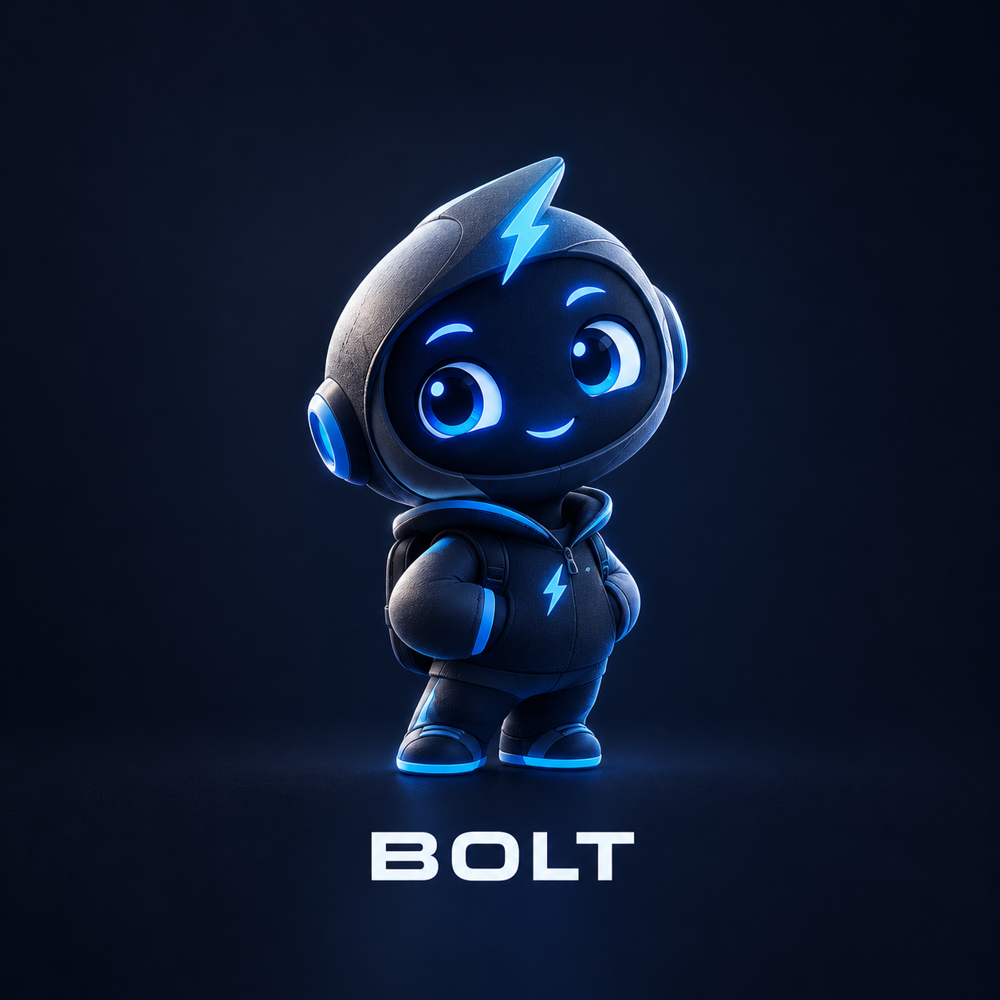

# Bloat Checker

> *Your codebase's little guardian.*

<p align="center">
  
</p>

Meet **BOLT**, the Bloat Checker companion mascot. BOLT serves as the project's watchful guardian, representing the tool's focus on catching newly added, unreferenced production dependencies before they merge.

Bloat Checker is an offline, zero-dependency policy enforcement tool for Node.js projects. In V1, it inspects change diffs against target Git revisions to detect newly added production dependencies in `package.json` that are never imported or referenced in project source code.

---

## What Bloat Checker V1 Does

- **Unused Dependency Detection**: Identifies newly added production dependencies in `package.json` that have zero references across project source files.
- **Fail-Closed Verification**: Exits with non-zero failure codes if base revisions cannot be resolved, required checks fail to execute, or output path traversals are attempted.
- **Offline & Zero Dependencies**: Operates entirely offline using standard Node.js built-ins (`node:fs`, `node:path`, `node:child_process`). Requires zero external npm packages.
- **Deterministic Policy Enforcement**: Evaluates change diffs deterministically, reporting findings with line citations and stable exit codes.

---

## Installation & Prerequisites

- **Runtime**: Node.js 20+ (ESM / ECMAScript Modules).
- **Dependencies**: None (`0` production dependencies, `0` devDependencies).
- **Repository Setup**: Requires a local Git repository clone.

To run the built-in test suite:
```bash
npm test
```

*Verification Note: The latest local test suite execution reported **60 passed, 0 failed, 1 skipped** (61 tests total across 14 suites).*

---

## CLI Usage

The primary entry point is `src/gate-runner.mjs`.

```bash
# Evaluate changes against a base Git revision
node src/gate-runner.mjs --base origin/main

# Evaluate changes against the prior commit
node src/gate-runner.mjs --base HEAD~1

# Generate a machine-readable JSON report artifact
node src/gate-runner.mjs --base origin/main --output-json bloat-report.json

# Evaluate currently staged changes
node src/gate-runner.mjs --staged
```

### Supported CLI Flags

| Flag | Argument | Description |
|---|---|---|
| `--base` | `<revision>` | Target base Git revision (e.g. `origin/main`, `HEAD~1`) to diff against. |
| `--repo` | `<path>` | Path to the repository root directory (defaults to current working directory). |
| `--ssot` | `<path>` | Path to a custom Single Source of Truth (SSOT) rule file. |
| `--output-json` | `<path>` | Path to write the structured JSON report artifact (must reside within repository root). |
| `--staged` | None | Evaluates staged Git changes rather than a commit range. |
| `--include-untracked` | None | Includes untracked files in change inspection. |
| `--json` | None | Emits the complete JSON report to stdout instead of human-readable text. |
| `--silent` | None | Suppresses console output. |

### Exit Codes

Bloat Checker returns deterministic exit codes suitable for CI/CD gates:

| Exit Code | Decision | Meaning |
|---|---|---|
| `0` | `SUCCESS` | Clean pass: all required checks completed with zero blocking violations. |
| `1` | `POLICY_FAILURE` | Policy failure: one or more verified blocking violations detected (e.g. unused production dependency). |
| `2` | `VERIFICATION_FAILURE` | Verification incomplete or failed closed: a required analyzer crashed or report writing failed. |
| `3` | `SETUP_ERROR` | Setup or configuration error: invalid repository root, unresolvable base revision, or invalid arguments. |

---

## CI Gate & GitHub Actions

Bloat Checker includes a GitHub Actions workflow in [`.github/workflows/bloat-checker.yml`](.github/workflows/bloat-checker.yml).

- **Triggers**: Runs on `pull_request` and `push` events targeting `main` and `master`.
- **Permissions**: Enforces least privilege with `contents: read`.
- **Artifacts**: Generates and uploads `bloat-report.json` as a build artifact named `bloat-checker-report`.
- **Merge Blocking Requirement**: The workflow defines the status check `Bloat Checker Policy Gate`. In GitHub, status checks do not automatically block pull request merges; merge blocking requires enabling GitHub Branch Protection on the target branch and selecting `Bloat Checker Policy Gate` as a required status check.
- **Verification Status**: The workflow configuration has been inspected locally but has not yet been verified in a live GitHub Actions runner.

---

## Companion Mascot

**BOLT** is Bloat Checker's mascot and visual companion - a symbolic sentinel representing vigilance against unnecessary dependency bloat. BOLT is not an AI assistant, autonomous agent, or code-generation capability; all checks and gate decisions in Bloat Checker are executed through deterministic static analysis.

---

## Documentation

For full CI architecture, security boundaries, and failure diagnosis details, see:
- [`docs/CI_GATE_AND_SECURITY.md`](docs/CI_GATE_AND_SECURITY.md)
